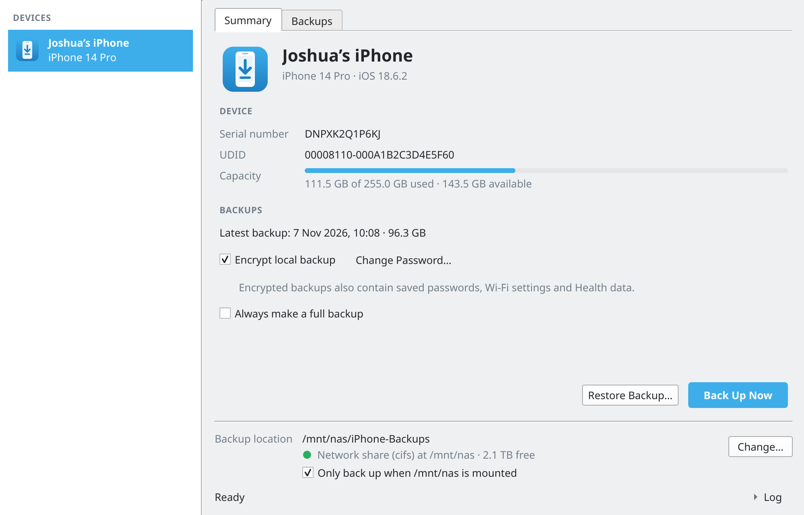
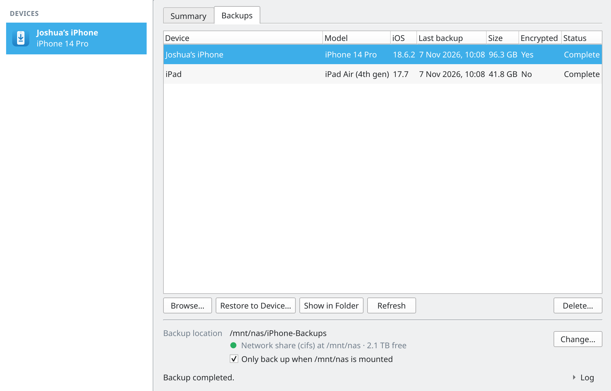
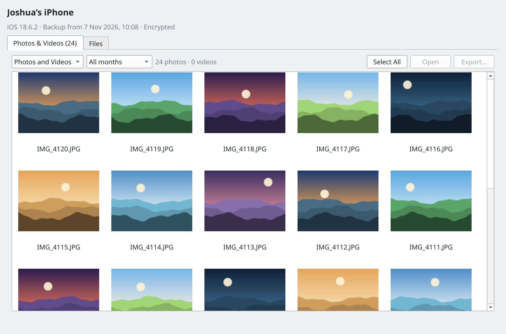

# iOS Backup for Linux

A desktop app for **Arch Linux / CachyOS** (Qt, fits right into KDE Plasma) that backs up,
restores and browses iPhone and iPad backups over USB – much like iTunes used to.
Backups can go to any folder, including a mounted NAS share.

The device communication is handled by [libimobiledevice](https://libimobiledevice.org/)
(`idevicebackup2`), so backups use the same format as iTunes and Finder.



## Features

- Detects connected iPhones and iPads (name, model, iOS version, storage)
- Pairing (“Trust This Computer?”) from within the app
- **Back up** with progress; later backups only transfer what changed
- **Restore**, including restoring one device’s backup onto a new device
- **Encrypted backups**: turn on/off and change the password. Passwords are never stored
  and never passed on the command line.
- **Backup list** with date, size, encryption and status; show in folder, delete
- **Backup browser**: view photos and videos from the camera roll and export them, or
  browse every file in the backup (app data, voice memos, …) – encrypted backups included
- **Mount guard**: refuses to back up when the NAS is not mounted, so nothing is written
  into the empty mount folder on your local disk

| Backups | Browsing a backup |
| --- | --- |
|  |  |

## Installation (CachyOS / Arch)

```bash
git clone https://github.com/ressjo/iosbackuplinux.git
cd iosbackuplinux/packaging/arch
makepkg -si
```

This installs the dependencies (`python`, `pyside6`, `python-cryptography`,
`libimobiledevice`, `usbmuxd`), the app and an “iOS Backup” launcher entry.

Optional, for HEIC photo and video thumbnails in the backup browser:

```bash
sudo pacman -S --needed kimageformats libheif ffmpegthumbnailer
```

To run from the source tree without packaging:

```bash
sudo pacman -S --needed python pyside6 python-cryptography libimobiledevice usbmuxd
PYTHONPATH=src python -m iosbackup
```

`usbmuxd` is started automatically by udev when a device is plugged in. If the app
reports that it is not running:

```bash
sudo systemctl start usbmuxd
```

## Usage

1. Connect the iPhone or iPad with a USB cable and unlock it.
2. When the device asks “Trust This Computer?”, tap **Trust** and enter the passcode.
3. Under **Backup location**, click **Change…** and pick a folder (for example on your NAS).
4. Click **Back Up Now**.

To **restore**, first turn off **Find My** on the target device (Settings → [your name] →
Find My). The device restarts when the restore is finished.

Backups are stored as `<backup location>/<UDID>/`. An encrypted backup cannot be restored
or browsed without its password, so keep it somewhere safe.

### Browsing a backup

On the **Backups** tab, select a backup and click **Browse…** (or double-click it). For an
encrypted backup you will be asked for the backup password; decrypting takes a few seconds.

- **Photos & Videos** shows the camera roll, filterable by type and month. Select items
  and click **Export…** to save the original files (HEIC/JPG/MOV) with their original
  dates. Double-click opens a file in your default viewer.
- **Files** shows every file in the backup, grouped into Camera Roll, Media, Apps and
  System, with search. Export single files or whole folders.

**No photos in the backup?** When **iCloud Photos** is turned on, iOS leaves the photos
out of local backups – they only live in iCloud.

Decrypted content is kept in memory or in a private temporary folder and deleted when the
browser window is closed.

### Forgot the backup password?

Neither the device nor Apple can tell you the password. You can remove it on the device
without losing data: **Settings → General → Transfer or Reset iPhone → Reset →
Reset All Settings** (*not* “Erase All Content and Settings”). This resets settings such as
Wi-Fi passwords and the wallpaper and turns off backup encryption. Backups made with the
old password remain unreadable.

## Notes

- A backup needs roughly as much space as the used storage on the device.
- Speed is mostly limited by USB 2.0 (Lightning and non-Pro USB-C iPhones) and by writing
  many small files to a network share.
- Do not disconnect the device during a backup or restore. Cancelling a backup is safe;
  cancelling a restore is not recommended.
- If something goes wrong, open **Log** in the bottom right corner – it shows the full
  output of `idevicebackup2`.

## Development

The tests run without a real device: `tests/fake_tools/` simulates the libimobiledevice
programs (including password prompts, errors such as “Find My” and cancellation), and
`tests/backup_factory.py` generates synthetic – optionally encrypted – backups.

```bash
QT_QPA_PLATFORM=offscreen python -m pytest -q
```

The screenshots above were taken with this simulated device.

## License

MIT
